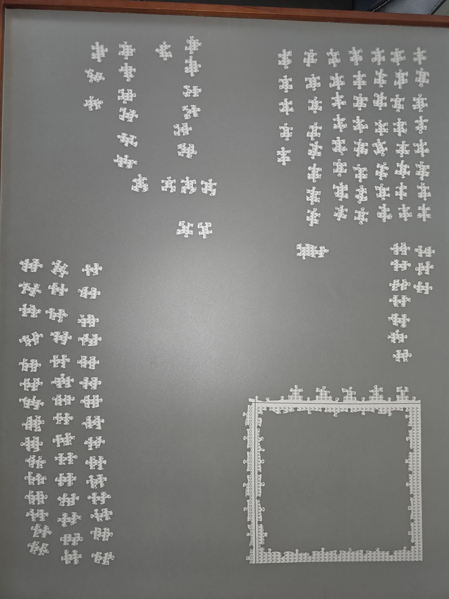

# Puzzle Assistant

A helper for assembling a jigsaw puzzle, one piece at a time. You can turn the helper on when you want a suggestion, and build on your own when you do not.

**Current status: planning; learning Python.** There is no program to run yet. This repository holds the goal, a photo of how the puzzle is sorted, and a roadmap you can follow one small test at a time. The real coding plan will be designed later, after your other project, once the first chapters of the book feel comfortable.

You are learning Python with Al Sweigart's *[Automate the Boring Stuff with Python](https://automatetheboringstuff.com/)*. You have the paper book, and the author publishes the same book free on that site. Chapter numbers change between editions. [ROADMAP.md](ROADMAP.md) lists each topic by name and gives the numbers for the 2nd and 3rd editions.

## The goal

The puzzle is sorted **face down**. Pieces from the same section have a letter printed over and over on the back (A, B, C, and so on). Where two sections meet, the back shows a straight line. The outside of the whole puzzle is the flat edge of a piece.

The long-term goal is a helper that looks at a photo and tells you which loose piece to place next, so a section can be filled in order. Guided suggestions start at the **top-left** and move **right across the row**, then down to the next row.

## How section A is laid out

The photo below is section **A**, taken on 13 October 2026. The border of the section is already built in the lower right. The remaining A pieces are loose, laid out in rows and columns on a grey board. Every piece back in the photo shows the letter A. The letter names the section. It does not tell one A piece from another. Telling pieces apart will depend on shape (tabs and blanks) and on where a piece sits relative to the frame.

The picture above is a smaller copy (1200×1600) so this page loads quickly. The original phone photo is [docs/images/section-A-frame-original.jpg](docs/images/section-A-frame-original.jpg) (4000×3000 pixels, about 2.8 MB, with the camera's rotation tag).

## What you do with your phone

The normal way to ask for an update is a photo you take when you want one. The puzzle may sit somewhere a webcam cannot see, so the phone is the camera.

1. You photograph the section.
2. The program studies that picture: loose pieces, the frame, and which spots are already filled.
3. Your phone shows the same picture back, with guidance drawn on it. In guided mode the next loose piece is circled in **blue**, and the spot where it goes is marked in **green**.

The phone opens a small web page served by the Ubuntu virtual machine on the same Wi-Fi. That page is part of a later software phase. Until it exists, you copy photos into the virtual machine by hand.

A webcam that watches the board continuously is a much later phase. Lasers or a projector are optional hardware after that. They would shine the same blue and green marks onto the board. The phone page is the guide you will actually use first.

## What the program should eventually do

1. **See a still photo.** Use OpenCV to find the loose pieces and the partly built section in a picture you just took.
2. **Suggest the next piece** when you ask for guidance: top-left, then right along the row, then the next row. Show that as blue on the piece and green on the empty spot.
3. **Notice a gap.** When the piece for the next spot seems to be missing, record that position.
4. **Show the answer on your phone**, on a page from a small local web app (Flask or FastAPI are the two options to consider).
5. **Let you talk back.** You can say the guess was wrong, say a missing piece has turned up, or place a different piece than the one suggested. Each correction is saved next to the guess (the photo, the predicted piece and position, a confidence number, what you said, and the time). Those saved rows are how matching gets better later, including a possible machine-learning model once there are enough examples.
6. **Work in the mode you want**, and switch at any time. You can build with the helper off. A new photo re-syncs the program to the board as it really is. You can also hold up any piece and ask where it belongs. The modes are described in [docs/assist-modes.md](docs/assist-modes.md), and the correction log in [docs/feedback-loop.md](docs/feedback-loop.md).
7. **Optional, much later:** a live camera, then lights (a projector, or lasers aimed by an Arduino or similar) that repeat the blue and green guidance. A Raspberry Pi could eventually sit by the table and run the finished system. None of that starts until the software phases work on phone photos.

## Where things are

| Path | What it is |
| --- | --- |
| [ROADMAP.md](ROADMAP.md) | Phases in order, each with a test you can pass |
| [docs/setup.md](docs/setup.md) | Ubuntu in VMware Workstation Pro, Python, Git, and GitHub |
| [docs/assist-modes.md](docs/assist-modes.md) | Off, guided, and "where does this go?" |
| [docs/feedback-loop.md](docs/feedback-loop.md) | How a correction is saved next to a guess |
| [docs/ideas.md](docs/ideas.md) | Tools worth considering later, and why |
| [docs/learning-log.md](docs/learning-log.md) | Dated notes while you learn |
| [docs/images/](docs/images/) | The section A reference photo |
| [requirements.txt](requirements.txt) | Starter libraries (OpenCV, NumPy, Pillow, Jupyter) |
| [src/](src/) | Future program code (empty for now) |
| [notebooks/](notebooks/) | Scratch space for Jupyter experiments |
| [photos/](photos/) | Puzzle photos you take (see the note about large files) |

## Suggested next step

Follow [docs/setup.md](docs/setup.md) so Ubuntu, Python, and GitHub work inside VMware. Then start the book at Python basics, and check items off in [ROADMAP.md](ROADMAP.md). When something clicks, or something is confusing, add a few lines to [docs/learning-log.md](docs/learning-log.md).
